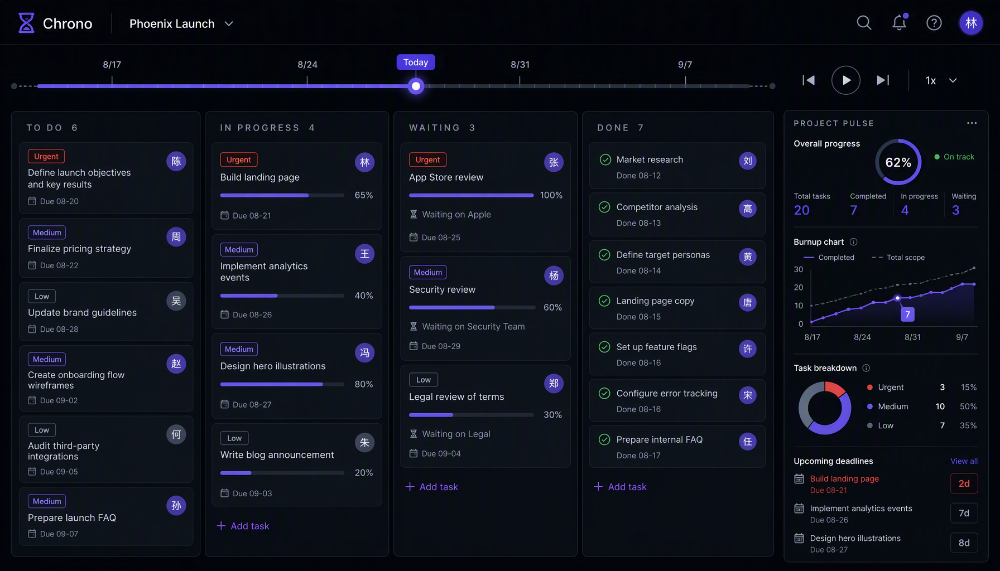
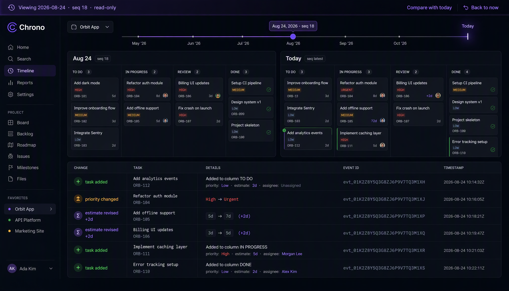
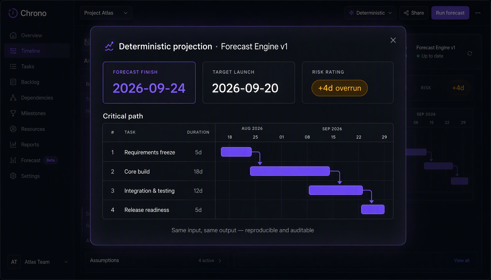

# Chrono — Temporal Decision Workspace

This repository presents Chrono's product and architecture. Application source is maintained privately.

**Replay the past. Understand the present. Rehearse and forecast the future.**

Chrono turns your project into a timeline of immutable events. Boards, diffs, scenarios, forecasts, and AI explanations are all projections of the same event stream — so every answer about your project comes with evidence, not memory.

> **Pre-launch.** A public deployment is not available yet. The images below are illustrative product previews.

[Product Preview](#product-preview) · [Architecture](#built-with) · [Feedback](https://github.com/Mike-Animal-Counseling/chrono-public/issues)

See the [current engineering status and remaining release gates](docs/PROJECT_STATUS.md).

## Why time is the missing dimension

Project tools show you *now*. But the decisions you actually make are about time:

- *"Why did the launch slip two weeks?"* — Chrono replays the exact sequence of estimate revisions and scope changes that caused it.
- *"What if we add two engineers?"* — Chrono rehearses it in a scenario branch before you commit.
- *"Can we still make the date?"* — Chrono projects it deterministically, with the critical path and the risk in days.

## Product Preview

### Replay & Compare — hold plans to evidence

Scrub the Temporal Rail to any moment and see the board exactly as it was. Compare any two points in time with a structured, event-level diff: what was added, re-prioritized, re-estimated, and when.

### Forecast — dates you can defend

A deterministic projection engine: topological order, capacity-aware working days, critical path, risk rating. Same input, same output — reproducible and auditable.

### Scenarios — rehearse before you commit

Branch off main, test staffing or scope changes in isolation, compare the branch against main, and apply it back as replayed commands when you're satisfied. Main is untouched until you say so.

### AI explain — answers with receipts

Ask *"why did the launch move?"* and get an answer grounded in the event trail, every claim linked to the events that prove it. Works with any OpenAI-compatible provider; degrades to deterministic analysis without a key.

### Built for everyday teamwork

- Task views: Board, Table, Calendar, Dependency canvas
- Realtime collaboration with presence (SSE); shared-state behavior is tested across two application processes in the private hardening work
- Offline edits queue by account and retry idempotently; rejected edits remain available for explicit recovery
- Trash with restore, per-task activity history derived from the event log

Private hosted-service work also implements verified-email onboarding/recovery,
team invitations, workspace billing/data controls and operator setup. Stripe
integration has passed local contract checks; real email, payment and deployment
acceptance remain launch gates. See the [engineering status](docs/PROJECT_STATUS.md).

### People and AI workers

Assign tickets to human teammates and AI workers. Twelve ready-made professions
have distinct Markdown skill collections and relevant tool selections; modules
load on demand for the task. Manual assignment stays the default, with optional
capacity-aware scheduling and human review. The first connector capability is
read/search/analyze; real provider accounts still need launch acceptance.
See [roles, skills and capability boundaries](docs/AI_WORKERS.md).

## Who it's for

Anyone who plans or delivers software: product managers, engineering managers, product leads, tech leads, founders — or a whole team trying out a time-aware way of working together.

## Feedback

I built Chrono to make project history a first-class feature. While the public deployment is being prepared, explore the product previews and [open an issue](https://github.com/Mike-Animal-Counseling/chrono-public/issues) with questions, ideas, or feedback. A working launch link will be added here when the service is available.

## Built with

Next.js · React · TypeScript · PostgreSQL · Prisma · event sourcing · deterministic forecast engine · Vitest

The core is an append-only event log: every change is an immutable event, and everything you see is a projection of that log — which is also why replay, compare, and scenarios are possible at all. Sessions are SHA-256-hashed server-side, all input is validated, and mutating APIs are same-origin enforced.

---

Chrono — work isn't only about now.

## Source

Application source is maintained privately. This repository publishes the shared
type + validation contract ([`packages/shared`](packages/shared)) and the Prisma
data model ([`prisma/schema.prisma`](prisma/schema.prisma)) — both MIT-licensed —
so the real stack is visible without exposing the event-sourcing and forecast
engines.
## Security and deployment

Read the [security policy](SECURITY.md) and [production requirements](docs/PRODUCTION_SECURITY.md) before deployment.