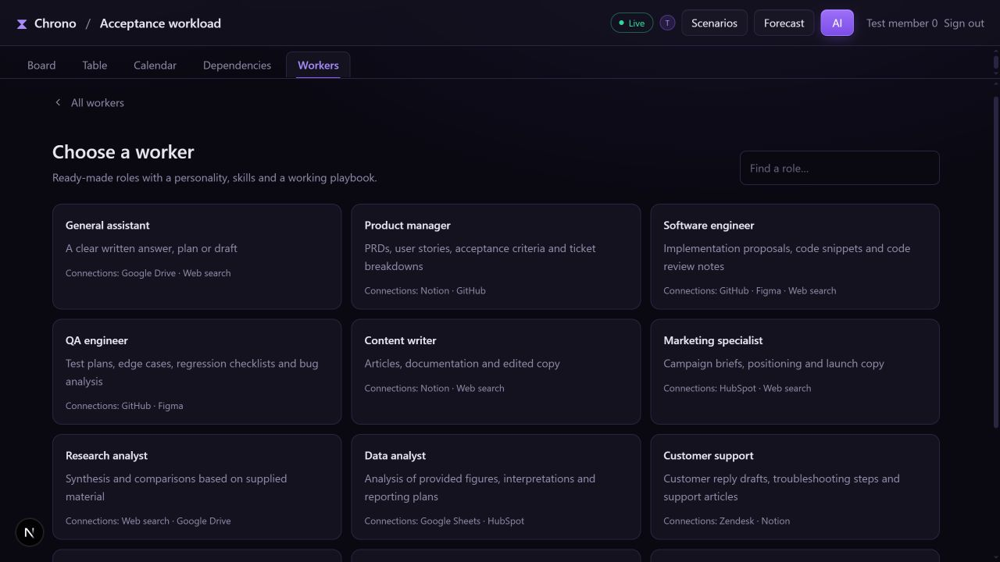

# People and AI workers

Chrono's private implementation combines human collaborators and AI execution
assignees in the same temporal workspace. This is pre-launch product work;
there is no public hosted service available yet.

## A role comes ready to use

Choose a profession, name the worker, authorize relevant accounts and assign a
ticket. Team preferences and advanced matching/capacity settings are optional.
Customers do not need to assemble a system prompt or maintain skill documents.

Twelve role packages contain 41 Markdown skill modules. Each includes a persona,
working playbook, specialist methods, tool-use guidance, completion checks and
expected deliverables. Engineering has eight modules spanning implementation,
review, debugging, regression coverage, repository context, frontend, backend
and security review. The other roles have their own specialist collections.

Task scheduling selects a compatible worker with capacity. A separate skill
router selects its starting module. The worker loads additional modules from
its own profession only when needed, keeping unrelated guidance out of context.

## Different roles, different tools

| Role | Default connection selection |
| --- | --- |
| General assistant | Google Drive, web search |
| Product manager | Notion, GitHub |
| Software engineer | GitHub, Figma, web search |
| QA engineer | GitHub, Figma |
| Content writer | Notion, web search |
| Marketing specialist | HubSpot, web search |
| Research analyst | Web search, Google Drive |
| Data analyst | Google Sheets, HubSpot |
| Customer support | Zendesk, Notion |
| Sales assistant | HubSpot, Gmail |
| Operations specialist | Notion, Slack |
| Product designer | Figma, Notion |

The connection adapter uses Composio and optional Tavily search. A toolkit name
does not grant access: the service must be configured and a workspace
administrator must authorize its account. Shared toolkit actions can also differ
by profession. Real-account OAuth, permissions and provider compatibility still
need launch acceptance.

The first built-in connector capability is **read/search/analyze**. It does not
send mail, publish, change repository code, create pull requests, execute tests
or edit a Figma canvas. An owned external agent may supply additional capabilities
under its own explicit permissions. No dedicated external agent platform is
advertised as integrated.

## Assign and follow the result

Manual assignment is the default. Optional smart scheduling matches eligible,
unowned tickets by skills, prerequisites and available agent capacity. Human
assignments stay with their people. Successful work completes automatically by
default; teams can require human review before Done.

Worker profiles and activity show reported progress, written deliverables and
execution history. The runtime keeps versioned task/skill context and shared
execution limits across application replicas. Provider keys, model quality,
retention terms, spending limits and chosen-host capacity require operator setup
and acceptance. Automatic completion is not independent proof of factual quality.

This is an implementation screenshot with synthetic data, not a public live
deployment. See [project status](PROJECT_STATUS.md) for acceptance boundaries.
